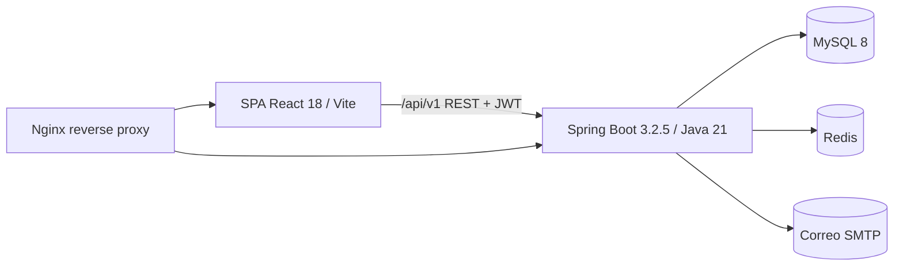

# Arquitectura — AAC27

> Documenta la arquitectura **ya existente** (brownfield). Las decisiones se registran como ADRs
> retroactivos en `docs/adr/`.

## Contexto del sistema
Actores: **Administrador** (gerente, opera todo el negocio), **Vendedor** (atención en tienda),
**Superadministrador** (soporte técnico, sin permisos de negocio), **Sistema** (procesos automáticos:
stock, notificaciones). Sistemas externos v1: correo SMTP (password provisional, notificaciones),
almacenamiento de imágenes (local/S3), generación de PDF interna.

## Contenedores

## Módulos y responsabilidades (backend `com.aac27.joyeria`)
- `config/` — Spring Security, JWT (`JwtUtil`, `JwtProperties`, `JwtAuthenticationFilter`), CORS, `CambioPasswordObligatorioFilter`.
- `shared/` — `response/ApiResponse`, `exception/` (+ `GlobalExceptionHandler`), `audit/BaseAuditEntity`, `mail/CorreoService`, `constant/RolConstants`.
- `module/seguridad` — auth, usuarios, roles, historial de contraseñas. ✅
- `module/catalogo` — categorías, subcategorías, materiales, productos, trazabilidad. ✅
- `module/compra` — compras, detalle, método de pago, crédito, `inventario_movimiento`, `ProductoLockRepository`. ⚠️
- `module/venta` — ventas, detalle, pagos, clientes, promociones, apartados. ⚠️
- `module/postventa` — casos, reparaciones, historial. ⚠️
- `module/proveedor` — solo entity + repository. 🔴 (siguiente feature SDD, T-10)

## Datos, seguridad, despliegue, observabilidad
- **Datos:** MySQL InnoDB; esquema por Flyway `V1…V10`; dinero `DECIMAL(14,2)`; auditoría inmutable.
- **Seguridad:** JWT stateless (access 8h / refresh 7d), RBAC con `@PreAuthorize` + filtro por propietario; BCrypt≥12; ver `docs/requirements/roles-permissions.md` y `docs/matriz-permisos.md`.
- **Despliegue:** Docker Compose (MySQL, Redis, backend, frontend/Nginx). Perfiles `dev`/`prod`.
- **Observabilidad:** Actuator (health/info/metrics); logs sin secretos; correlation id pendiente (T-33).

## Estrategia de pruebas
Unitarios (services) · integración (Testcontainers/MySQL en flujos stock/dinero) · e2e (Playwright,
login + POS). Separación Surefire (`*Test`) / Failsafe (`*IT`) pendiente (T-31).

## Índice de ADRs
- ADR-0001 — Monolito modular por dominio.
- ADR-0002 — Autenticación JWT stateless.
- ADR-0003 — MySQL + Flyway (migraciones versionadas inmutables).
- ADR-0004 — Concurrencia de stock (optimistic `@Version` + locking).
- ADR-0005 — DTOs separados con MapStruct; `ApiResponse<T>` estandarizado.
