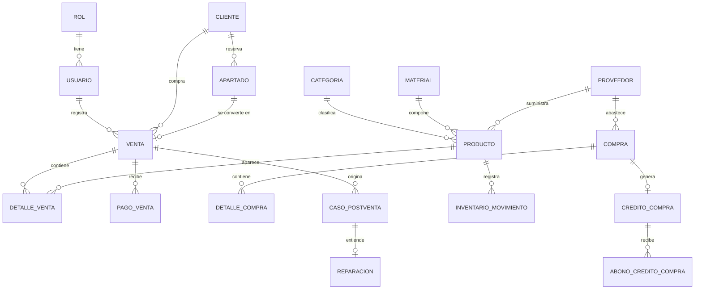
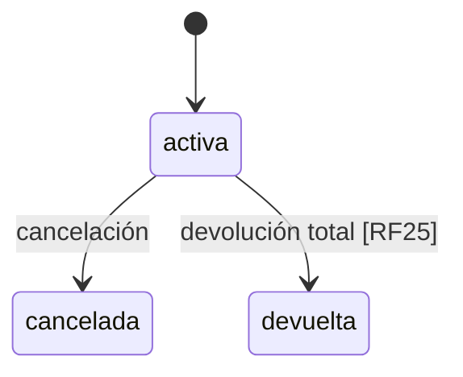
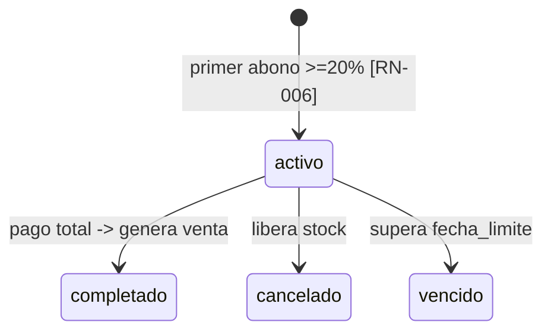
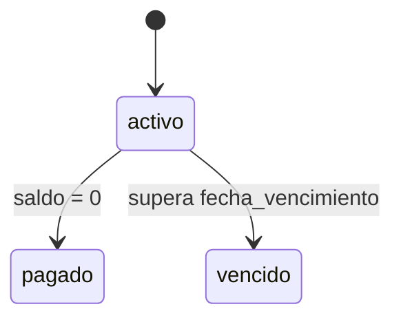
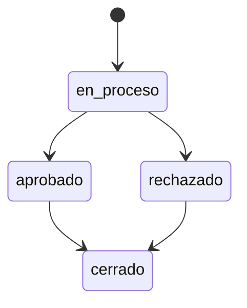

# Modelo de dominio — AAC27

> Derivado del diccionario de datos de `REQUISITOS_Y_ARQUITECTURA_AAC27.md` §3 (29 tablas) y de las
> reglas de estado ya codificadas. Fuente de verdad del esquema: migraciones Flyway `V1…V10`.

## Entidades clave (invariantes)
- **Producto** — SKU `codigo` único; `precio_venta > precio_costo` (RN-003); `stock ≥ 0` (RN-002); `@Version` para concurrencia (RN-004).
- **Venta** — `numero_factura` consecutivo único; inmutable tras registrar (RN-010); total recalculado en backend (RN-009).
- **Apartado** — primer abono ≥20% (RN-006); bloquea stock; estados RN-007.
- **Crédito de compra** — un activo por compra; `0 ≤ saldo ≤ total` (RN-008).
- **Inventario_movimiento** — append-only; guarda `stock_antes`/`stock_despues` (desnormalización intencional).
- **Auditoria_log** — inmutable (RN-014).

## Relaciones (ER simplificado)

## Ciclos de vida (máquinas de estado)

### Venta — `estado_venta`

Pago: `estado_pago` pendiente → pagado (saldo 0) · pendiente → vencido (plazo superado).

### Apartado — `estado` [RN-007]

### Crédito de compra — `estado` [RN-008]

### Caso postventa — `estado`

Reparación (si `tipo=reparacion`): recibido → en_proceso → listo → entregado.

## Clasificación de datos
| Dato | Clase | Cifrado en reposo | Retención |
|---|---|---|---|
| password_hash | Restringido | BCrypt (hash) | vida de la cuenta |
| token_recuperacion | Restringido | hash | 15 min |
| datos cliente (documento, contacto) | Confidencial | — (BD protegida) | según normativa |
| auditoria_log | Interno | — | ≥1 año |
| catálogo, precios | Interno | — | histórico |
